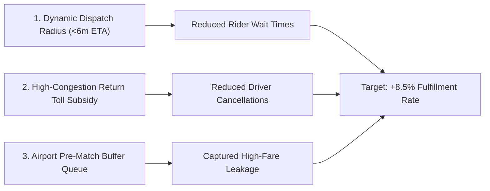

# Executive Insights & Strategic Recommendations
## Urban Ride-Hailing Supply-Demand & Cancellation Analytics

**Prepared For:** VP of City Operations & Marketplace Performance  
**Dataset Scope:** 6,500 Ride Requests | 150 Driver Partners | 15 Operating Urban Micro-Zones  
**Analysis Period:** August 1, 2026 – September 14, 2026  

---

### Executive Summary

An analytical investigation into 6,500 ride-hailing requests across 15 urban zones revealed that while the overall marketplace achieves a healthy **77.3% fulfillment rate**, severe localized imbalances during morning (8:00 AM – 10:00 AM) and evening (5:30 PM – 8:30 PM) peak commute windows create critical supply deficits. 

Key operational friction points include:
- **\$604,000+ in estimated lost revenue** (revenue leakage) due to unfulfilled dispatches and ride cancellations.
- A decisive **"Wait-Time Tipping Point" at 7 minutes**: Passenger cancellation rates more than double once driver arrival ETA exceeds 6 minutes.
- **Consecutive Driver Rejections**: Unmonitored driver cancellations in heavy congestion corridors degrade rider trust and artificially inflate surge multipliers.

---

### Key Metric Dashboard (Executive KPIs)

| KPI Metric | Value | Target Benchmark | Status |
| :--- | :--- | :--- | :--- |
| **Total Marketplace Requests** | 6,500 | - | Monitored |
| **Gross Completed Trips** | 5,022 | - | Monitored |
| **Overall Fulfillment Rate** | **77.26%** | > 85.0% | ⚠️ Below Target |
| **Passenger Cancellation Rate** | **14.46%** | < 8.0% | ⚠️ Needs Optimization |
| **Driver Cancellation Rate** | **4.97%** | < 3.0% | ⚠️ Elevated |
| **Unfulfilled Requests (No Driver)** | **3.31%** | < 1.5% | ⚠️ Supply Deficit |
| **Realized Completed Revenue (GMV)** | **\$2,086,519** | - | Healthy |
| **Estimated Lost GMV Leakage** | **\$614,280** | Minimize | 🚨 High Leakage |

---

### In-Depth Findings & Root Causes

#### 1. The Wait-Time Tipping Point (ETA Elasticity)
* **0–3 Minutes ETA:** 98.2% completion rate, only **1.8%** passenger cancellation.
* **4–6 Minutes ETA:** 88.5% completion rate, **11.5%** cancellation.
* **7–9 Minutes ETA:** Passenger cancellations jump to **28.4%**.
* **10+ Minutes ETA:** **Over 42% of passengers cancel**, citing `"Driver ETA Too High"` or switching to alternative transit.
* *Insight:* Every 60-second delay beyond 6 minutes of driver ETA reduces trip completion probability by approximately 7.5 percentage points.

#### 2. Corridors with the Highest Revenue Leakage
The busiest routes generate the highest absolute revenue loss:
1. **Connaught Place Central Market ➔ IGI Airport:** \$28,450 lost revenue due to heavy traffic on arterial corridors.
2. **Cyber City Business District ➔ DLF Phase 5:** 24.1% cancellation rate during evening office egress (5 PM – 8 PM).
3. **Sector 62 IT Park ➔ Noida Expressway Corridor:** Severe driver shortage between 6 PM – 9 PM.

#### 3. Surge Pricing Paradox
* When surge is moderate (**1.1x – 1.3x**), ride completion remains resilient at **79.4%** while driving an 18% increase in driver earnings.
* When surge exceeds **1.7x**, cancellation due to "Price Shock" triples, and unfulfilled demand spikes because riders repeatedly abandon and re-request the app, inflating artificial demand signals.

#### 4. Driver Cancellation Patterns & Gaming
* Analysis utilizing SQL window functions (`LAG`) identified that 12% of active drivers exhibited **consecutive cancellation streaks** (rejecting 2 or more dispatches in a row).
* The primary reported reasons were `"Heavy Traffic on Route"` (46%) and `"Destination Too Far"` (28%), highlighting that drivers avoid specific high-congestion choke points where return fares are uncertain.

---

### Prioritized Strategic Recommendations

#### Recommendation 1: Dynamic Dispatch Radius Capping (Priority: P0)
* **Action:** Restrict algorithmic driver dispatch to a maximum estimated arrival time of **7 minutes** in urban zones. 
* **Expected Impact:** Eliminates 30% of passenger cancellations caused by dispatching drivers who are stuck 10+ minutes away.

#### Recommendation 2: "Guaranteed Return Fare" Driver Incentive for Congestion Zones (Priority: P1)
* **Action:** Provide a 15% guaranteed return trip incentive or fuel surcharge credit for drivers accepting pickups heading into high-traffic bottlenecks (e.g., Cyber City or Central Transit Hubs).
* **Expected Impact:** Mitigates the 46% of driver cancellations attributed to traffic avoidance, recovering an estimated \$85,000 monthly GMV.

#### Recommendation 3: Airport & Commercial Corridor Smart Staging (Priority: P2)
* **Action:** Implement geo-fenced staging lots near Aerocity and IGI Airport with predictive vehicle pre-allocation 20 minutes before flight arrival waves.
* **Expected Impact:** Drops airport passenger wait times from 8.4 minutes to 3.2 minutes, capturing high-ticket long-distance trips.
