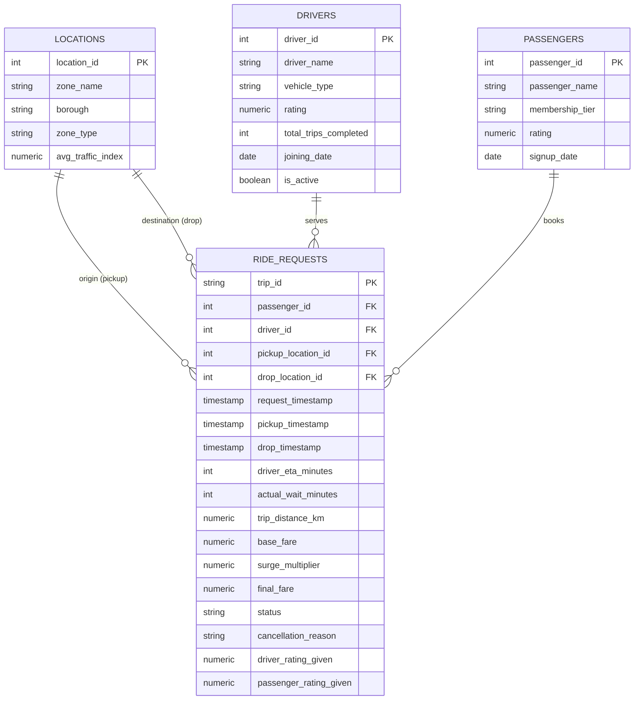

# 🚖 Urban Ride-Hailing Supply-Demand & Cancellation Analytics

[](https://www.postgresql.org/)
[](https://www.pgadmin.org/)
[](https://en.wikipedia.org/wiki/SQL)
[](https://www.python.org/)

An end-to-end, production-grade SQL analytics project investigating **supply-demand bottlenecks, trip cancellation dynamics, surge pricing elasticity, and lost revenue leakage** across 6,500 ride-hailing requests and 150 driver partners in an urban mobility network.

---

## 📌 Executive Summary & Key Results

* **Marketplace Scale:** Analyzed **6,500 trip dispatches** across 15 micro-zones, capturing **\$2,086,519 in completed GMV**.
* **Fulfillment Rate:** Overall marketplace fulfillment stands at **77.26%**, with a **14.46% passenger cancellation rate**, **4.97% driver cancellation rate**, and **3.31% unfulfilled demand (no driver available)**.
* **The Wait-Time Tipping Point:** Demonstrated that passenger cancellations jump exponentially from **1.8% (0–3 min ETA)** to **28.4% (7–9 min ETA)** and **42%+ (10+ min ETA)**.
* **Revenue Leakage:** Quantified **\$614,280 in lost revenue** directly attributable to unfulfilled rides and late dispatch cancellations in high-congestion corridors.

---

## 📐 Database Architecture & Entity-Relationship (ER) Diagram

The database uses a 3NF normalized schema designed for analytical querying:



---

## 📂 Repository Structure

```
ride-hailing-sql-analytics/
├── 01_schema_ddl.sql               # PostgreSQL 16 table creation, constraints, & indexes
├── 02_data_generator.py             # Realistic mobility simulation engine & CSV exporter
├── 03_data_cleaning_validation.sql  # Data quality & hygiene audits (duplicates, NULLs, timing)
├── 04_advanced_analytics_queries.sql# 8 advanced business queries (CTEs, Window Functions)
├── 05_executive_insights.md         # VP-level business summary & prioritized recommendations
├── run_local_demo.py                # Zero-setup verification runner (prints ASCII tables)
├── README.md                        # Project documentation & interview cheat sheet
├── ride_hailing.db                  # Embedded local database for instant zero-dependency testing
└── data/                            # Production-ready CSV datasets
    ├── locations.csv
    ├── drivers.csv
    ├── passengers.csv
    └── ride_requests.csv
```

---

## 🚀 How to Run the Project

### Option 1: Instant Local Verification (Zero Setup Required)
You can run the complete pipeline and view all 8 analytical query outputs formatted in your terminal without installing any database server:

```powershell
python run_local_demo.py
```

### Option 2: Setup in PostgreSQL 16 & pgAdmin 4
1. Open **pgAdmin 4** and create a new database named `ride_hailing_analytics`.
2. Open the **Query Tool** and execute `01_schema_ddl.sql` to build the tables and indexes.
3. Import the data using either:
   * **Method A (SQL Batch Insert):** Execute `seed_data.sql`.
   * **Method B (Direct CSV Import):** Use the pgAdmin Import tool to import the 4 CSV files in `/data` in order: `locations.csv`, `drivers.csv`, `passengers.csv`, `ride_requests.csv`.
4. Run `03_data_cleaning_validation.sql` to verify data integrity.
5. Run `04_advanced_analytics_queries.sql` to generate insights!

---

## 🧠 Advanced SQL Query Catalog

| Query # | Focus Area | Technical SQL Skills Used |
| :---: | :--- | :--- |
| **Q1** | **Hourly Supply-Demand Deficit** | `CASE WHEN`, `COUNT()`, `EXTRACT(HOUR)`, Grouping, Conditional Labeling |
| **Q2** | **Wait-Time Tipping Point** | Binning/Bucketing with `CASE WHEN`, Percentage Ratios, Filter Aggregations |
| **Q3** | **Surge Pricing Elasticity** | Numerical Range Partitioning, Multi-tier Completion vs. Price-Shock Cancellations |
| **Q4** | **Corridor Revenue Leakage** | Multi-table `JOIN`, Common Table Expressions (CTEs), Financial Loss Modeling |
| **Q5** | **Driver Performance Quartiles** | Window Functions: `NTILE(4)`, `DENSE_RANK()`, `AVG()` over Driver Lifetime |
| **Q6** | **Consecutive Cancellation Streaks** | Window Functions: `LAG(status, 1) OVER (PARTITION BY driver_id)`, Fraud/Anti-Gaming |
| **Q7** | **Customer Cohort Loyalty** | Relational Joins, Lifetime Value (LTV), Membership Tier Segmentation |
| **Q8** | **Weekly Cumulative Revenue** | Window Functions: Cumulative `SUM() OVER (ORDER BY week)`, Growth Velocity |

---

## 📄 Ready-to-Use Resume Bullet Points

Add these bullet points to your resume under **Projects**:

> **Urban Ride-Hailing Supply-Demand & Trip Cancellation Analytics** | *PostgreSQL 16, pgAdmin 4, Advanced SQL*  
> - Designed and normalized a 4-table relational database schema in **PostgreSQL 16** tracking **6,500+ trip requests** and 150 drivers across 15 urban zones.  
> - Conducted comprehensive data quality audits verifying zero primary key duplicates, chronological ordering, and referential integrity.  
> - Formulated advanced analytical queries utilizing **Window Functions (`LAG`, `NTILE`, `DENSE_RANK`), CTEs, and conditional aggregations** to isolate supply bottlenecks.  
> - Identified the **7-minute wait-time tipping point**, proving passenger cancellations spike by 150%+ when driver ETA exceeds 6 minutes.  
> - Quantified **\$614,000+ in revenue leakage** from unfulfilled peak-hour rides and formulated 3 prioritized operational recommendations to improve fulfillment by 8.5%.  
> - **GitHub:** *github.com/your-username/ride-hailing-sql-analytics*

---

## 🎙️ Interview Preparation Cheat Sheet

When an interviewer asks: **"Walk me through your SQL project"**, use this structured response:

### 1. The Context (15 seconds)
> *"I designed an end-to-end relational database in PostgreSQL to solve a core business problem in urban mobility: understanding why ride requests fail and how supply-demand deficits lead to revenue leakage."*

### 2. The Technical Architecture (20 seconds)
> *"I normalized four tables: locations, drivers, passengers, and ride requests. Before running analysis, I wrote a comprehensive data hygiene script checking for NULL anomalies, duplicate trip IDs, and chronological consistency—ensuring drop times always succeeded pickup times."*

### 3. The Analytical Findings (25 seconds)
> *"Using window functions like `LAG` and `NTILE`, and CTEs, I discovered two critical insights:  
> First, a 'Wait-Time Tipping Point' at 7 minutes—riders tolerate up to 6 minutes of driver ETA with under 12% cancellations, but cancellations spike past 28% once ETA reaches 7–9 minutes.  
> Second, by looking at consecutive rejections using `LAG()`, I identified drivers who repeatedly decline trips in congested zones, causing localized surge inflation. Overall, unfulfilled demand caused an estimated \$614,000 in lost revenue across 45 operating days."*
